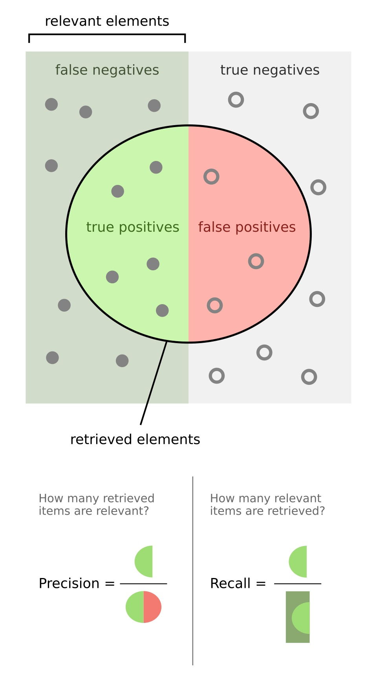
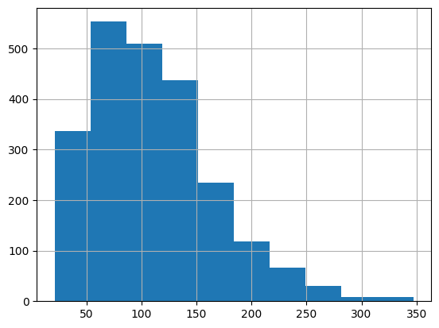
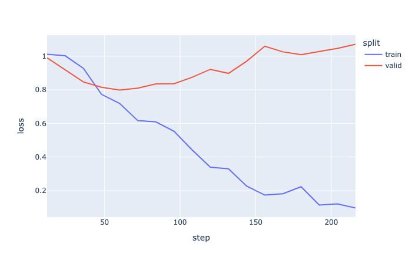
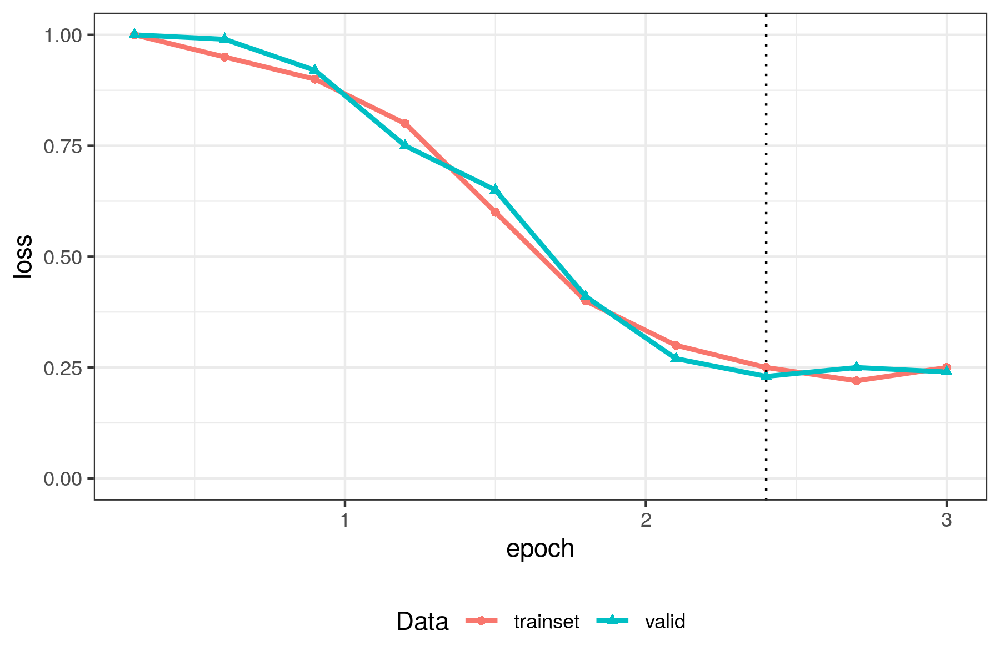
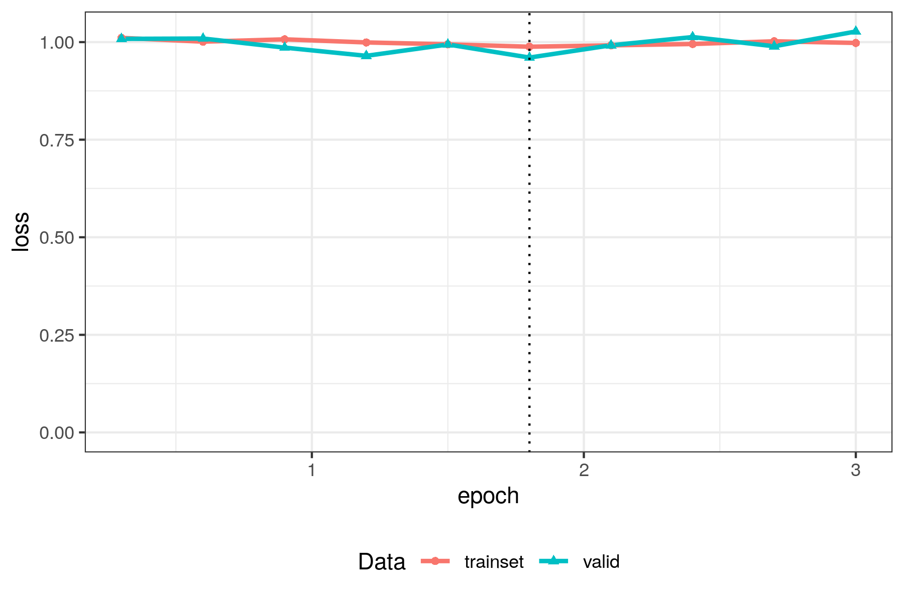
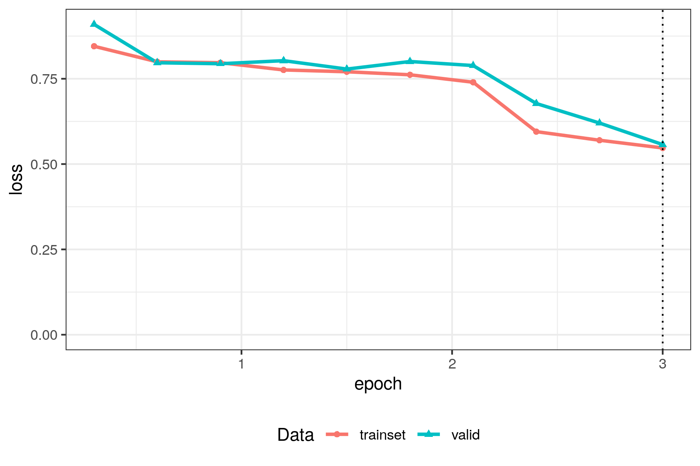
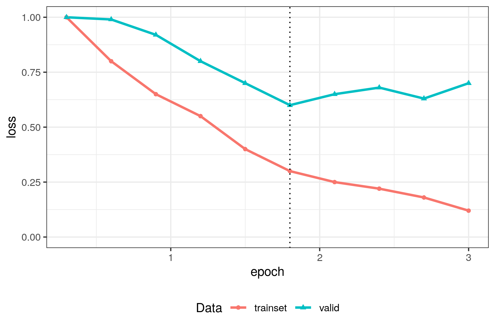
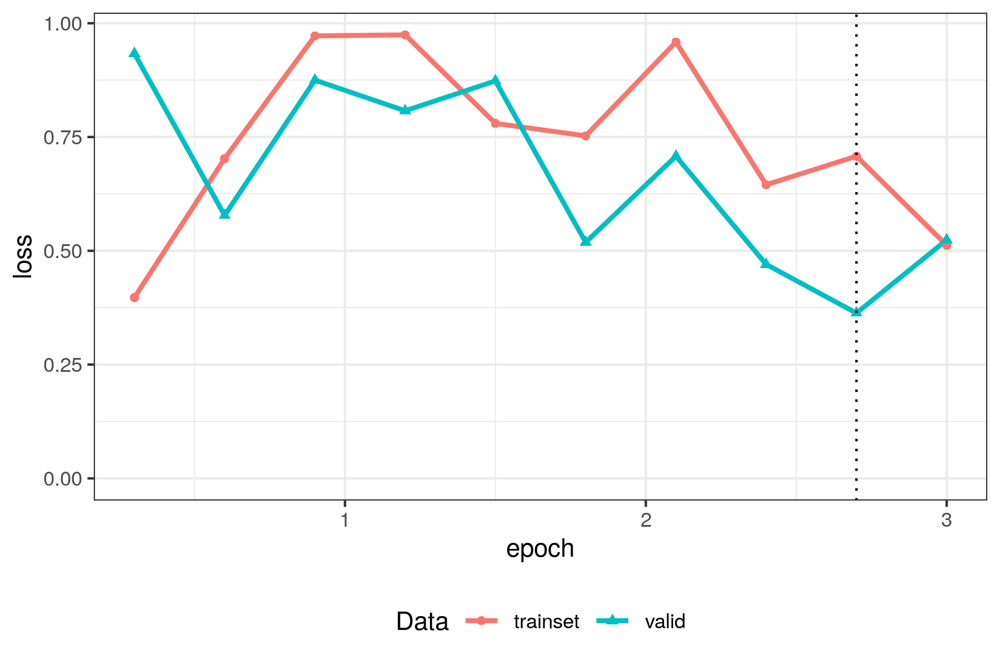

# Introduction

Social scientists working with large corpora of documents (tweets, abstracts, newspaper articles, videos...) often need to annotate each item with one or more labels to conduct analysis, such evolution of topics or modelisation. Common strategies include hiring interns, outsourcing to a company such as MTurk, or automating the task with various strategies. Since the development of LLMs, it has become common practice to use them as annotators in social science contexts (Gilardi et al., 2023; Bonikowski et al, 2022). For instance, cne such study annotated 4.5 million tweets addressed to French members of parliament with the labels "attack", "critique" or "support" to describe the conditions of hate speech towards them on Twitter. In Machine Learning jargon, this is a "classification task".

This tutorial is part of a series on using LLMs as annotators. A companion [tutorial](https://www.css.cnrs.fr/classification-with-generative-llms-and-api-calls/) covers the generative AI (genAI) approach: writing a prompt and parsing the label out of the model's response. Here, we cover another approach using specific models called encoders (an LLM that does not generate text[^smaller-info]), fine-tuned on an annotated sample the way a human expert would learn the task[^supervised-learning-disclaimer]. This gives you more control over the model and its performance, at the cost of (a bit) more NLP knowledge and coding skill.

[^smaller-info]: Smallest generative models weigh 16GB ([Llama-3-8B](https://huggingface.co/meta-llama/Meta-Llama-3-8B-Instruct/tree/main)) and larger ones can reach 850GB ([Deepseek-V4-pro](https://huggingface.co/deepseek-ai/DeepSeek-V4-Pro/tree/main)). The open weights[^open-weights] encoder models used here weigh from 500MB ([google-bert/bert-base-uncased](https://huggingface.co/google-bert/bert-base-uncased)) to 2.3GB ([FacebookAI/xlm-roberta-large](https://huggingface.co/FacebookAI/xlm-roberta-large/tree/main)).

[^open-weights]: Meaning you can download the model to your own machine, unlike most proprietary models.

[^supervised-learning-disclaimer]: This is the supervised learning framework, briefly recalled in a refresher at the end of @sec-objectives.

**Why not just use ChatGPT?** Generative models (GPT, Llama, Claude) are prompted: you describe your categories and hope the model interprets them as you would, every time. An encoder (BERT and its relatives) produces no text but an **embedding**, a numerical representation of a text's meaning[^transformer], and is **fine-tuned** on texts you label yourself. You thus control the whole pipeline: the model can only assign the categories you defined, learned from your annotations and nothing else. A generative model brings everything it learned elsewhere into each decision, and may read into a text things that are not in it. Its errors are then not random but biased: Ashwin et al. (2025) found that a generative LLM's coding errors on interviews with Rohingya refugees were correlated with respondents' characteristics, whereas a model fine-tuned on human-coded transcripts showed less bias.

Using small models helps to keep your data **confidential**: encoders are light enough to run on your own machine or a trusted server[^7], so sensitive corpora never go through an external API. And they keep your results **reproducible**: closed generative models can change after an update, while you own the encoder and its fine-tuning data. Finally, they are cheaper to run on large corpora, and a few hundred annotated texts are often enough (Laurer et al., 2024; Bucher & Martini, 2024). The price is the annotation effort, more code, and a model that performs a single task. But even this cost has its avantage : you learn a lot during the annotation process.

[^transformer]: Most language models are built on the **Transformer** architecture, introduced by Google in 2017 (Vaswani et al., 2017). It is the same word behind the `transformers` Python library used throughout this tutorial.

[^7]: Most likely: newer models tend to be larger, see [Choose and load a model](#choose-and-load-a-model).

This tutorial fine-tunes an **encoder model**: we load and format a dataset, load the model and set its hyperparameters, launch fine-tuning, assess performance, and tune hyperparameters to improve it. We close with advice on incorporating the results into a social science project, including hardware tips along the way.

## Objectives and materials{#sec-objectives}

This tutorial will:

- Identify the main NLP concepts needed to work with encoder models.
- Walk through the general pipeline for text classification with encoder models.
- Build familiarity with preprocessing and training techniques.
- Explain how to read evaluation results for this task.
- Discuss how to incorporate this step into your research using current best practices.

It will **not** cover:

- Python syntax: we assume you already know the language. See [Lino Galiana's course](https://pythonds.linogaliana.fr/) if you don't.
- Supervised learning in depth: we assume you have an annotated dataset to fine-tune on, and only recall the essentials of the framework (training a classifier, splitting annotations into train, valid and test sets) and its standard metrics (precision, recall, accuracy, F1 score) in the refresher below. See the [scikit-learn user guide](https://scikit-learn.org/stable/supervised_learning.html) to go further, and Pustejovsky & Stubbs (2012) or Krippendorff (2018) for annotation.
- The fundamentals of NLP and linguistics, beyond what's necessary here. See [Jurafsky](https://web.stanford.edu/~jurafsky/slp3/).
- How to turn your research question into an annotation protocol: we assume you can design and motivate that yourself.

A notebook with all cells pre-run is available [here](https://github.com/albandrp/encoder-classifier-tuto/blob/main/tuto.ipynb).

:::{.callout-note collapse="true" title="Refresher: the classification task in machine learning"}

The classification task is a concept from machine learning: an algorithm uses input data (the predictors) to assign a class, or label, to each input. [Scikit-learn](https://scikit-learn.org/stable/)[^scikit-learn] puts it this way: _Identifying which category an object belongs to._ The connection with annotation is direct: each text needs to be assigned a label, so annotating is a classification task.

[^scikit-learn]: The most widely used Python library for machine learning. It has had a major impact on the coding community, notably by establishing the `.fit` / `.transform` syntax.

Classification belongs to the **supervised learning** family: to assign labels, the algorithm must first be **fitted** on **training data**, _in our case handmade annotations_. Fitting (or training) consists of providing inputs and their labels, so that the algorithm adapts to the task and _"learns"_ it. Social scientists therefore first need to annotate a small set of texts to train the classifier.

Classifiers often have structuring settings called **hyperparameters**, which shape how the algorithm learns and are not changed during training. They must be set with care to reach satisfying performance.

To evaluate classifiers, we use [normalised metrics](https://scikit-learn.org/stable/modules/model_evaluation.html#which-scoring-function-should-i-use) such as [precision](https://en.wikipedia.org/wiki/Precision_and_recall), [recall](https://en.wikipedia.org/wiki/Precision_and_recall), [accuracy](https://en.wikipedia.org/wiki/Accuracy_and_precision#In_binary_classification) and the [F1 score](https://en.wikipedia.org/wiki/F-score#Definition). Depending on your research, you may want to optimise one metric or another:

- **Precision**: _"out of all the elements predicted as class A, how many were indeed from class A?"_ This metric is rather conservative: optimising it limits the number of false positives.
- **Recall**: _"out of all the elements that should have been classified as A, how many were indeed classified as A?"_ This metric is more inclusive: optimising it limits the number of false negatives.
- **Accuracy**: _"across all classes, how many elements were classified correctly?"_ It can be misleading when classes are imbalanced: a model that always predicts the most frequent class can score high while never recognising the rare ones.
- **F1 score**: the harmonic mean of precision and recall, which balances the two.

{width=50%}

To assess a model correctly and prevent cherry-picking, we evaluate it on distinct subsets of texts and annotations:

- **The train set**: the texts shown to the algorithm to _learn_ from. Metrics on the train set are inflated, since the model has already seen these texts.
- **The valid set**: texts used to assess the algorithm on new data, and to choose the hyperparameters. Metrics on the valid set are likely to be somewhat inflated too, since the hyperparameters were chosen to optimise them.
- **The test set**: texts used once, at the end, to assess the algorithm with the chosen hyperparameters on new data. Metrics on the test set are meant to represent the algorithm's performance on new data, and are the ones you should report, to avoid cherry-picking.

:::

# Key concepts and valuable resources to start your NLP journey{#sec-key-concepts}

This tutorial **fine-tunes** a **pretrained** **encoder** model to perform a **classification** task. This section explains these terms, at a level sufficient to follow the rest of the tutorial.

The models used here are **neural networks**. Their behaviour is entirely determined by a large set of adjustable quantities called **parameters** (also known as weights and biases), and **training** a model means adjusting these parameters until it produces the output you expect.

An **encoder** turns a text into an **embedding**: a numerical representation of its meaning. Texts close in meaning get close embeddings, a proximity measured by a similarity score (@fig-similarity). BERT (Devlin et al., 2019) is the best-known encoder; CamemBERT (French), RoBERTa and ModernBERT are later variants. This tutorial uses `bert-base-uncased`.

{#fig-similarity width=100%}

Models don't read words but **tokens**: words or pieces of words from the model's vocabulary, into which texts are split before use. Every encoder has a **context window**, the maximum number of tokens it processes at once. Anything beyond is ignored, so long texts may have to be split into sentences or paragraphs (older models read 128 to 512 tokens). It is important for encoders since their context windows are smaller than generative models.

A **pretrained** model has already learned how a language works, by reading very large amounts of general text such as Wikipedia, books or web pages. This step requires computing power and data out of reach of most research teams, so it is done by companies and research labs, who often share the resulting models publicly; this tutorial downloads its model from Hugging Face, the main platform for doing so. **Fine-tuning** adjusts its parameters slightly with your annotations, to turn it into a classifier for your own labels. It is quick: a few minutes, at most a few dozen on limited hardware.

Fine-tuning proceeds by small successive corrections: the model reads a **batch** of annotated texts, compares its predictions with your annotations, and adjusts its parameters slightly to reduce the gap between the two, called the **loss**. It then moves to the next batch, and repeats until it has gone through the whole train set: one **epoch**. The settings that control this loop (how many texts per batch, how large each correction is, how many epochs) are called hyperparameters; we introduce them when diagnosing training problems (@sec-hyperparameters-tuning).

To check that the model learned your categories rather than memorised your examples, annotations are split into three sets: the model learns from the **train** set, you compare settings on the **valid** set, and the **test** set is kept aside for one final, unbiased score.

:::{.callout-note collapse="true" title="Learn more about neural networks, Transformers and encoders"}

- [3Blue1Brown, *Neural networks*](https://www.youtube.com/playlist?list=PLZHQObOWTQDNU6R1_67000Dx_ZCJB-3pi): a visual, intuition-first video series, a good entry point with no prior exposure.
- [Michael Nielsen, *Neural Networks and Deep Learning*](http://neuralnetworksanddeeplearning.com/): a free, self-contained online book.
- [The illustrated transformer](https://jalammar.github.io/illustrated-transformer/)
- [What are Transformer Neural Networks](https://www.youtube.com/watch?v=XSSTuhyAmnI)
- [Code your own transformer model](https://nlp.seas.harvard.edu/annotated-transformer/)
- Jurafsky & Martin, the reference NLP textbook: chapters on [tokenization](https://web.stanford.edu/~jurafsky/slp3/2.pdf), [neural networks](https://web.stanford.edu/~jurafsky/slp3/7.pdf) and [Transformers](https://web.stanford.edu/~jurafsky/slp3/8.pdf).

:::

## Install environment

This tutorial uses Python 3.12:

```bash
pip install -qU pandas "transformers==4.52.4" datasets ipykernel matplotlib torch "accelerate>=0.26.0" scikit-learn plotly "nbformat>=4.2.0"
```

[PyTorch](https://pytorch.org/) and [Transformers](https://huggingface.co/docs/transformers/index) are well documented, with large communities that have already debugged most version-compatibility issues you'll hit. We recommend a virtual environment manager such as conda[^4], and keeping track of your library versions to save debugging time later.

[^4]: [Set up your cuda environment](https://www.youtube.com/watch?v=sDCtY9Z1bqE)

# Fine-tuning pipeline: the essential{#sec-essentials}

We use a dataset introduced by Luo et al. (2020): sentences extracted from journal articles, each annotated as "agreeing", "neutral" or "disagreeing" with the statement "Climate change/global warming is a serious concern". The pipeline:

- Load, clean and split your data into train, valid and test sets.
- Choose a model from Hugging Face and load it locally.
- Fine-tune the model.
- Assess performance and tune hyperparameters.
- Predict labels for the full dataset.

```{mermaid}
flowchart LR
  A[Split into<br/>train / valid / test] --> B[Annotated sample (first train, then valid)]
  B --> C[Fine-tune<br/>on train]
  C --> D[Evaluate on valid]
  D -- not good enough --> E[Adjust settings]
  E --> C
  D -- good enough --> F[Final check<br/>on test]
  F --> G[Label the<br/>full corpus]
  G --> H[Analysis]
```

## Load and preprocess your data{#sec-preprocess}

Data is available on the [project's GitHub repository](https://github.com/yiweiluo/GWStance/tree/master):

```python
import pandas as pd

url = "https://raw.githubusercontent.com/yiweiluo/GWStance/refs/heads/master/3_stance_detection/1_MTurk/full_annotations.tsv"
df_raw = pd.read_csv(url, sep = "\t") # Careful here, this document is a tsv (separator="\t" and not a csv, separator = ",")

df_raw.head()
```

|    | MACE_pred | av_rating | sentence | worker_0 | worker_1 | sent_id | ... |
|---|---|---|---|---|---|---|---|
|  0 | disagrees   |      -1     | Global warming is a hoax.                                                                                                                            | disagrees  | disagrees  | s0        | ... |
|  1 | neutral     |       0.375 | Alarming levels of sea level rise are predicted to threaten Florida over the next decades.                                                           | neutral    | neutral    | s1        | ... |
|  3 | agrees      |       1     | Global warming is happening and it will be dangerous to human health and welfare.                                                                    | agrees     | agrees     | s3        | ... |

The columns that matter: `sentence` (the text to annotate), `MACE_pred` (the debiased final label, built from several MTurk workers' annotations via the MACE framework), and `av_rating` (their average rating). `worker_#N` holds individual annotations; `disagree`/`agree`/`neutral`/`round`/`batch` are empty or irrelevant here. `sent_id` is not unique.

```python
df = df_raw.loc[:,["sent_id", "sentence", "MACE_pred", "av_rating"]]
df = df.rename(columns={"MACE_pred" : "label_text"}) # Rename MACE_pred for conveniency
df
```

```python
df.groupby(["label_text"]).size()
```

```txt
label_text
agrees       871
disagrees    441
neutral      988
dtype: int64
```

Classes are imbalanced: "disagrees" has about half as many examples, which will make it harder to classify well.

A few preprocessing essentials:

**A unique ID**, since `sent_id` isn't one:

```python
df["ID"] = [f'ID-{i:04}' for i in range(len(df))]
```

**Document length**: check it fits the model's context window (@sec-key-concepts), and catch obvious issues such as empty texts:

```python
df["sentence-len"] = df["sentence"].apply(len)
df["sentence-len"].hist()
df["sentence-len"].describe()
```

```txt
count    2300.000000
mean      109.890435
std        56.251317
min        21.000000
25%        70.000000
50%       100.000000
75%       145.000000
max       347.000000
Name: sentence-len, dtype: float64
```

{#fig-sentence-length-hist width=50%}

These sentences are short and fairly uniform in length, so we won't filter on it. Performance is not guaranteed for texts very different in length, tone or source from the training data.

**Unwanted characters**: unlike TF-IDF, transformer models are trained on punctuation and benefit from keeping it; strip only what carries no semantic value for your task (e.g. emojis, if your model doesn't recognise them[^recognise-emojis]). Here we just fix some punctuation irregularities:

[^recognise-emojis]: Check that the model you're using recognises emojis before deciding to keep or strip them.

```python
def preprocess_text(text: str):
    if not(isinstance(text, str)):
        return pd.NA
    return (
        text
        .replace("``", '"')
        .replace("''", '"')
        .replace(" ,", ",")
        .replace(" .", ".")
        .replace(" !", "!")
        .replace(" ?", "?")
        .replace(" :", ":")
        .replace(" 's", "'s")
    )

df["sentence-preprocessed"] = df["sentence"].apply(preprocess_text)
```

**Duplicates**, which can bias training by over-weighting repeated examples:

```python
df.groupby("sentence").size().value_counts()
```

```txt
1     2034
2        8
50       5
Name: count, dtype: int64
```

5 sentences are duplicated 50 times each, all with `sent_id` starting in "s":

```python
df_no_duplicates = df.loc[~df["sent_id"].str.startswith("s"), :]
```

The remaining 8 duplicates are handled in the [appendices](./appendices.qmd#sec-duplicates); load the result directly:

```python
df_clean = pd.read_csv("./data/dataset-no-duplicates.csv")
df_clean
```

|    | sent_id   | sentence                | label_text   |   av_rating | ID      |   sentence-len | sentence-preprocessed   |
|---|---|---|---|---|---|---|---|
|  0 | t0        | Warmer-than-normal s... | agrees       |       0.625 | ID-0005 |            170 | Warmer-than-normal s... |
|  1 | t1        | We will continue to ... | neutral      |       0     | ID-0006 |             94 | We will continue to ... |
|  2 | t10       | The actual rise in s... | neutral      |       0     | ID-0007 |            118 | The actual rise in s... |

2035 rows remain.

**Splitting the data** into train (70%, the texts the model learns from), valid (15%, used to pick hyperparameters) and test (15%, reserved for a final, unbiased read of performance). The split is random, so we fix a **seed**: anyone running the code again gets the same split, and results close to the ones below (small differences remain from one machine to another).

```python
from datasets import Dataset, DatasetDict

SEED = 2306406
ds = Dataset.from_pandas(df_clean)

temp = ds.train_test_split(test_size = 0.3, shuffle = True, seed = SEED)
ds_train = temp["train"]
temp = temp["test"].train_test_split(test_size = 0.5, shuffle = True, seed = SEED)
ds_valid = temp["train"]
ds_test = temp["test"]

dsd = DatasetDict({
  "train": ds_train,
  "valid": ds_valid,
  "test": ds_test
})
```

```
DatasetDict({
    train: Dataset({
        features: ['sent_id', 'sentence', 'label_text', 'av_rating', 'ID', 'sentence-len',
        'sentence-preprocessed'],
        num_rows: 1424
    })
    valid: Dataset({
        features: ['sent_id', 'sentence', 'label_text', 'av_rating', 'ID', 'sentence-len',
        'sentence-preprocessed'],
        num_rows: 305
    })
    test: Dataset({
        features: ['sent_id', 'sentence', 'label_text', 'av_rating', 'ID', 'sentence-len',
        'sentence-preprocessed'],
        num_rows: 306
    })
})
```

## Choose and load a model{#choose-and-load-a-model}

We use the Transformers package, maintained by [Hugging Face](https://huggingface.co/)[^huggingface], and start with [google-bert/bert-base-uncased](https://huggingface.co/google-bert/bert-base-uncased).

[^huggingface]: Hugging Face maintains several widely used libraries ([Transformers](https://huggingface.co/docs/transformers/index), [Datasets](https://huggingface.co/docs/datasets/index), [Sentence Transformers](https://sbert.net/)), publishes tutorials, hosts a debugging forum, and offers inference/training infrastructure if you lack the hardware.

:::{.callout-note title="How to choose a model" collapse="true"}
Model performance is sensitive to task and context: try several and compare. Criteria to weigh:

- **Task**: browse [Hugging Face's models](https://huggingface.co/models) by task; here, **Text Classification**.
- **Language**: multilingual models can underperform monolingual ones on a single-language corpus; consider a monolingual model, or translating your corpus first.
- **Training/evaluation domain**: performance varies by domain, so check the model's documentation for benchmarks close to yours.
- **Relevance**: download counts are a rough proxy for popularity and (to some extent) performance; a drop can signal a newer model has taken over.
- **Size**: your hardware sets a hard ceiling: know it, and check what you can run given it.
:::

We load it with an AutoModel class[^auto-models], here [`AutoModelForSequenceClassification`](https://huggingface.co/docs/transformers/en/model_doc/auto#transformers.AutoModelForSequenceClassification):

[^auto-models]: Auto classes are ready-to-use classes that set up the right architecture for your task.

```python
from transformers import AutoModelForSequenceClassification, set_seed

set_seed(SEED) # The classifier layer is initialised randomly: fix the seed here too

labels = list(df["label_text"].unique())
num_labels = len(labels)
id2label = {id:label for id, label in enumerate(labels)}
label2id = {label:id  for id, label in enumerate(labels)}

MODEL_NAME = "google-bert/bert-base-uncased"
model = AutoModelForSequenceClassification.from_pretrained(
    MODEL_NAME,
    num_labels=num_labels,
    id2label=id2label,
    label2id=label2id,
)
```
:::{.callout-warning}
Note: some models require `trust_remote_code=True`. Make sure you actually trust the model you're downloading before setting it.
:::

:::{.callout-note title="Model description" collapse="true" #nte-model-description}
Inspect the architecture directly:

```python
print(model)
```

```txt
BertForSequenceClassification(
  (bert): BertModel(

    >>> First step of the encoding process: ready-made embeddings that attention
    will modify. 30522 is the vocab size (one ready-made embedding per entry);
    768 is the output embedding dimension.

    (embeddings): BertEmbeddings(
      (word_embeddings): Embedding(30522, 768, padding_idx=0)
      (position_embeddings): Embedding(512, 768)
      (token_type_embeddings): Embedding(2, 768)
      (LayerNorm): LayerNorm((768,), eps=1e-12, elementwise_affine=True)
      (dropout): Dropout(p=0.1, inplace=False)
    )

    >>> Where attention happens: a stack of 12 BertLayers, each with a self-attention
    module. Output embedding dimension is still 768.

    (encoder): BertEncoder(
      (layer): ModuleList(
        (0-11): 12 x BertLayer(
          (attention): BertAttention(
            (self): BertSdpaSelfAttention(
              (query): Linear(in_features=768, out_features=768, bias=True)
              (key): Linear(in_features=768, out_features=768, bias=True)
              (value): Linear(in_features=768, out_features=768, bias=True)
              (dropout): Dropout(p=0.1, inplace=False)
            )
            (output): BertSelfOutput(
              (dense): Linear(in_features=768, out_features=768, bias=True)
              (LayerNorm): LayerNorm((768,), eps=1e-12, elementwise_affine=True)
              (dropout): Dropout(p=0.1, inplace=False)
            )
          )
          (intermediate): BertIntermediate(
            (dense): Linear(in_features=768, out_features=3072, bias=True)
            (intermediate_act_fn): GELUActivation()
          )
          (output): BertOutput(
            (dense): Linear(in_features=3072, out_features=768, bias=True)
            (LayerNorm): LayerNorm((768,), eps=1e-12, elementwise_affine=True)
            (dropout): Dropout(p=0.1, inplace=False)
          )
        )
      )
    )

    >>> Takes the embedding of each token in the sequence and produces one
    embedding meant to best represent the whole sequence.

    (pooler): BertPooler(
      (dense): Linear(in_features=768, out_features=768, bias=True)
      (activation): Tanh()
    )
  )
  (dropout): Dropout(p=0.1, inplace=False)

  >>> The classifier layer: a 768 + 3 node network. out_features=3 is the
  number of labels we're annotating for.

  (classifier): Linear(in_features=768, out_features=3, bias=True)
)
```

:::

:::{.callout-note title="Tips and tricks: read the model configuration" collapse="true"}

`AutoConfig` surfaces details that model documentation sometimes omits:

```python
from transformers import AutoConfig
print(AutoConfig.from_pretrained(MODEL_NAME))
```

```txt
BertConfig {
  "architectures": [
    "BertForMaskedLM"
  ],
  "attention_probs_dropout_prob": 0.1,
  "classifier_dropout": null,
  "gradient_checkpointing": false,
  "hidden_act": "gelu",
  "hidden_dropout_prob": 0.1,

  >>> Embedding dimension
  "hidden_size": 768,

  "initializer_range": 0.02,
  "intermediate_size": 3072,
  "layer_norm_eps": 1e-12,

  >>> Maximum context window
  "max_position_embeddings": 512,

  "model_type": "bert",
  "num_attention_heads": 12,
  "num_hidden_layers": 12,
  "pad_token_id": 0,
  "position_embedding_type": "absolute",
  "transformers_version": "4.52.4",
  "type_vocab_size": 2,
  "use_cache": true,

  >>> Vocab size identified earlier
  "vocab_size": 30522
}
```
:::

## Fine-tune the model

Three steps remain: tokenize the dataset, set the training arguments, and launch training.

### Tokenize the dataset{#sec-tokenization}

Tokenizing happens in two steps: text is split into tokens from the model's vocabulary, then each sequence is truncated or padded to a fixed length.

Load the tokenizer[^tokens-def-2] the same way as the model:

[^tokens-def-2]: See @sec-key-concepts for what tokenization is and why it's needed.

```python
from transformers import AutoTokenizer

tokenizer = AutoTokenizer.from_pretrained(MODEL_NAME)
```

:::{.callout-tip title="Example" collapse="true"}
```python
tokenizer("Hello World! 😇")
# {'input_ids': [101, 7592, ...], 'token_type_ids': [0, 0, ...], 'attention_mask': [1, 1, ...]}
tokenizer("Hello World! 😇").input_ids
# [101, 7592, 2088, 999, 100, 102] <- the token ids
tokenizer.decode([101, 7592, 2088, 999, 100, 102])
# '[CLS] hello world! [UNK] [SEP]'
# [CLS] is the starting token and [SEP] the terminating one.
# The smiley is marked as unknown [UNK]
tokenizer.decode([101])
# '[CLS]' <- token number 101
tokenizer.decode([2088, 999])
# 'world!' <- tokens number 2088 and 999
tokenizer(
  ["This sentence is very long. " * 20, # Very long
   "Short."],                           # Very short
  truncation = True,
  padding = "max_length",
  max_length = 50,
  return_tensors = "np"
).input_ids.shape
# (2, 50) <- long entries are truncated and short ones are padded so that all tokenized entries are the same length
```
:::

Set the tokenizer's parameters inside a preprocessing function and apply it:

```python
def preprocess_dataset(row: dict):
  tokenized_entry = tokenizer(
    row["sentence-preprocessed"],
    truncation = True,
    padding = "max_length",
    max_length = 400,
  )
  return {
      **row.copy(),
      "labels": int(label2id[row["label_text"]]),
      **tokenized_entry
  }

dsd = dsd.map(preprocess_dataset)
# Only keep columns useful for training
dsd = dsd.select_columns(['ID', 'labels', 'input_ids', 'token_type_ids', 'attention_mask'])
# Set the dataset dict format to torch
dsd = dsd.with_format("torch")
dsd
```

```
DatasetDict({
    train: Dataset({
        features: ['ID', 'labels', 'input_ids', 'token_type_ids', 'attention_mask'],
        num_rows: 1424
    })
    valid: Dataset({
        features: ['ID', 'labels', 'input_ids', 'token_type_ids', 'attention_mask'],
        num_rows: 305
    })
    test: Dataset({
        features: ['ID', 'labels', 'input_ids', 'token_type_ids', 'attention_mask'],
        num_rows: 306
    })
})
```

The data is ready for fine-tuning.

### Setup fine-tuning hyperparameters{#sec-training-parameters}

Fine-tuning parameters live in the `TrainingArguments`[^training-or-fine-tuning] object. Below are the main ones; the full list of [117 parameters](https://huggingface.co/docs/transformers/v4.49.0/en/main_classes/trainer#transformers.TrainingArguments) is in the documentation. What each hyperparameter does, and how to tune it, is covered in @sec-hyperparameters-tuning.

[^training-or-fine-tuning]: The syntax is the same whether training from scratch or fine-tuning, hence the training-related class names (`Trainer`, `TrainingArguments`...), but we are still fine-tuning a pretrained model.

```python
from transformers import TrainingArguments, Trainer
training_arguments = TrainingArguments(
    # Hyperparameters
    num_train_epochs = 5,
    learning_rate = 5e-5,
    weight_decay  = 0.0,
    optim = "adamw_torch_fused",
    # Second order hyperparameters
    per_device_train_batch_size = 4,
    per_device_eval_batch_size = 4,
    gradient_accumulation_steps = 8,
    # Pipe
    output_dir = "./models/training",
    eval_strategy = "steps"   , eval_steps    = 0.05,
    logging_strategy = "steps", logging_steps = 0.05,
    save_strategy = "steps"   , save_steps    = 0.05,
    load_best_model_at_end = True,
    save_total_limit = 2,
    seed = SEED,

    disable_tqdm = False,
)
```

### Launch fine-tuning

Two more lines start the process:

```python
trainer = Trainer(
    model = model,
    args = training_arguments,
    train_dataset=dsd["train"],
    eval_dataset=dsd["valid"],
)

trainer.train()
```

|   Epoch |   Step |   Training loss |   Validation loss |
|--------:|-------:|----------------:|------------------:|
|   0.270 |     12 |          1.0120 |            0.9907 |
|   0.539 |     24 |          1.0008 |            0.9204 |
|   0.809 |     36 |          0.9244 |            0.8510 |
|   1.067 |     48 |          0.7749 |            0.8047 |
|   1.337 |     60 |          0.7288 |            0.8248 |
|   1.607 |     72 |          0.6364 |            0.8035 |
|   1.876 |     84 |          0.6013 |            0.8248 |
|   2.135 |     96 |          0.5545 |            0.8105 |
|   2.404 |    108 |          0.4433 |            0.8682 |
|   2.674 |    120 |          0.3497 |            0.8927 |
|   2.944 |    132 |          0.3249 |            0.9290 |
|   3.202 |    144 |          0.2342 |            0.9748 |
|   3.472 |    156 |          0.1716 |            1.0218 |
|   3.742 |    168 |          0.1890 |            0.9909 |
|   4.000 |    180 |          0.2307 |            0.9774 |
|   4.270 |    192 |          0.1184 |            1.0162 |
|   4.539 |    204 |          0.1343 |            1.0317 |
|   4.809 |    216 |          0.1041 |            1.0443 |

Fine-tuning takes about 15 minutes on a recent laptop.

This produces a list of folders[^save-strategy], each holding:

[^save-strategy]: Depending on the `save_strategy` you set.

- `config.json`: the model config, similar to `AutoConfig`.
- `model.safetensors`: all model weights.
- `optimizer.pt`, `rng_state.pth`, `scheduler.pt`: the optimizer, RNG state and scheduler at that point.
- `trainer_state.json`: metadata up to that checkpoint.
- `training_args.bin`: a copy of the training arguments.

`trainer.state.best_model_checkpoint` holds the path to the best one, where validation loss reaches its minimum: here, checkpoint 72 (`'./models/training/checkpoint-72'`), with a validation loss of 0.80. Reload a checkpoint the same way as the original model:

```python
reload_model = AutoModelForSequenceClassification.from_pretrained(
    trainer.state.best_model_checkpoint)
```

## Use model for inference and evaluate performance{#sec-evaluation}

Once you have a new fine-tuned model, you can use it on elements to predict the label. But we also need to verify that those predictions are correct.

To do so, we predict labels on the valid set (@sec-preprocess), then compare against one gold annotations using standard metrics: accuracy, precision, recall, F1. We use a dedicated valid set to be able to compare different versions of a model, and different models, on the same standard.

::::{.columns}
:::{.column-body}
```python
import numpy as np
import torch
from tqdm import tqdm

IDs = []
y_gold = []
y_pred = []

# Reload the best model:
model = AutoModelForSequenceClassification.from_pretrained(trainer.state.best_model_checkpoint)
model.eval()

for batch in tqdm(dsd["valid"].iter(batch_size = 8)):
  IDs += [batch["ID"]]
  y_gold += [batch["labels"]]
  with torch.no_grad():
    logits = model(input_ids = batch["input_ids"], attention_mask = batch["attention_mask"]).logits.softmax(1).numpy()
    y_pred += [np.argmax(logits, axis=1)]
results = pd.DataFrame({
  "ID": np.concat(IDs),
  "gold": np.concat(y_gold),
  "pred": np.concat(y_pred)
})
```
:::

:::{.callout-note}
A step-by-step breakdown of these objects is in the [appendices](./appendices.qmd#sec-ins-and-outs).
:::
:::{.column-margin}
This snippet assumes the model is on CPU. See @sec-GPU for GPU/MPS.
:::
::::

We recommend macro[^macro-def] F1 as the most representative single number, since it handles class imbalance well. `scikit-learn`'s [`classification_report`](https://scikit-learn.org/stable/modules/model_evaluation.html#classification-metrics) computes everything at once:

[^macro-def]: "Macro" means the evaluation normalises across labels. Example in [the appendices](./appendices.qmd#sec-macro-micro).

```python
from sklearn.metrics import classification_report

print(classification_report(
    y_true = results["gold"].map(id2label),
    y_pred = results["pred"].map(id2label)
))
```
```txt
              precision    recall  f1-score   support

      agrees       0.67      0.73      0.70       116
   disagrees       0.64      0.48      0.55        61
     neutral       0.69      0.73      0.71       128

    accuracy                           0.68       305
   macro avg       0.67      0.64      0.65       305
weighted avg       0.68      0.68      0.67       305
```

Performance on "agrees" and "neutral" is decent but would benefit from further tuning. "Disagrees", the rarest label, is the weakest: the model misses about half of these texts (recall 0.48). Overall, at 0.65 macro F1, this run is mediocre: @sec-advanced tunes the hyperparameters to do better.

### What's a good score?

There's no universal "good enough" threshold: it depends on the task. Compare against these instead of judging the raw number alone:

- **A trivial baseline**: how would always predicting the majority class, or guessing at random, score? Barely beating that means the model hasn't learned much.
- **Human agreement**: inter-annotator agreement from your own annotation process (e.g. two coders on a shared sample) is a realistic ceiling: texts humans disagree on, the model won't reliably get right either. Approaching that agreement is about as good as it practically gets.
- **Intended use**: an exploratory, descriptive use (e.g. roughly characterising prevalence over time) tolerates more noise than a causal claim, where misclassified items can bias conclusions in a specific direction.

As a rough rule of thumb, macro F1 in the 0.7–0.9 range is typical for a usable social science classifier, but validate against the criteria above, not the number alone.

Once you've settled on a model and its hyperparameters, run the same code **once** on `dsd["test"]`: since none of your choices were based on it, this is the unbiased score to report.

## Predict labels for the full dataset{#sec-predict}

The same loop labels texts you haven't annotated. Clean them with `preprocess_text` and tokenize them as in @sec-tokenization (without the `labels` line of `preprocess_dataset`, since they have no label), then keep the predictions:

```python
# In your project: your unannotated texts, preprocessed and tokenized like dsd
ds_corpus = ...

IDs = []
y_pred = []
for batch in tqdm(ds_corpus.iter(batch_size = 8)):
  IDs += [batch["ID"]]
  with torch.no_grad():
    logits = model(input_ids = batch["input_ids"], attention_mask = batch["attention_mask"]).logits.softmax(1).numpy()
    y_pred += [np.argmax(logits, axis=1)]

predictions = pd.DataFrame({
  "ID": np.concat(IDs),
  "label_pred": pd.Series(np.concat(y_pred)).map(id2label)
})
predictions.to_csv("./outputs/predictions.csv", index = False)
```

## Conclusion{#sec-essentials-conclusion}

This section covered: knowing your corpus and preprocessing accordingly, choosing a model for the task, preparing data for fine-tuning, launching it, and evaluating with classification metrics. That's enough to fine-tune most classification models with Hugging Face's `AutoModelForSequenceClassification` pipeline, but @sec-evaluation showed mediocre performance. @sec-advanced tunes the hyperparameters to improve it and covers GPU/MPS, which this pipeline didn't use.

# Training pipeline: advanced practices{#sec-advanced}

## Diagnose and fix training problems{#sec-hyperparameters-tuning}

Checkpoints from @sec-essentials include the learning curve: the loss (the gap between predicted and gold labels) tracked on the train and valid sets as training progresses. Retrieve it from the trainer[^log-on-disk] and plot it:

[^log-on-disk]: The same log is saved in the `trainer_state.json` file of the last checkpoint, if you need it after closing your session.

```python
import plotly.express as px

loss = []

for log in trainer.state.log_history:
    step = log["step"]
    if "loss" in log:
        loss += [{"step": step, "loss": log["loss"], "split": "train"}]
    elif "eval_loss" in log:
        loss += [{"step": step, "loss": log["eval_loss"], "split": "valid"}]
    else:
        print(log)

loss = pd.DataFrame(loss)

px.line(loss, x = "step", y = "loss", color =  "split")
```

{#fig-learning-curve width=70%}

Train loss decreases steadily towards 0, while valid loss decreases, reaches a minimum, then rises: the model is memorising the train set past the point where it stopped generalising better, which is why we reload the checkpoint at the minimum (@sec-evaluation), not the last one. What matters is how low that minimum is, and how the two curves sit relative to each other. The pattern to aim for:

::::{.columns}

:::{.column width=50%}

**The perfect case**

- Both curves went down: the model learned.
- Both curves sit at similar values: no overfitting.
- Both are flat at the end: nothing more to learn.

Once your curve looks like this, check the evaluation metrics for prediction quality. If it doesn't, one of the problems below is the likely cause, and each comes with the hyperparameters that fix it.

:::

:::{.column width=50%}



:::

::::

**Problem 1: the model hasn't learned enough**

::::{.columns}

:::{.column width=50%}



:::

:::{.column width=50%}



:::

::::

At one extreme, both curves stay flat (left): metrics are barely better than chance, and the corrections were too small or too few. At the other, both curves are still falling with no plateau (right): the model is learning correctly, just not finished.

- **Learning rate** 🟢🟢🟢 _(importance)_ sets the size of each correction. It is the most consequential hyperparameter. Too low, fine-tuning leaves the model essentially unchanged; try increasing it. Typical values: $[1e-6, 1e-4]$.
- **Number of epochs** 🟢 sets how many passes through the training set. If performance was still improving when training stopped, add more. Typical values: 3-5 (more costs more compute time).

**Problem 2: the model has learned your training set by heart**

{width=50%}

The model performs well on texts it trained on and noticeably worse on valid: both curves fell, but train sits much lower than valid. It has memorised the training examples instead of learning the underlying distinction. This is **overfitting**, the most common failure here, especially with few annotations.

- **Weight decay**[^alias-weight-decay] 🟢🟢 discourages extreme parameter values, the usual mechanism behind memorisation. Increasing it constrains the model toward more general solutions; too high and it can't learn at all. Typical values: 0.01-0.1.
- Lowering the **learning rate** or **epochs** works the same way: fewer, gentler corrections leave less room to fit the specifics of your examples.
- The most reliable fix isn't a hyperparameter: annotate more data.

**Problem 3: the fine-tuning is erratic**

{width=50%}

Performance swings between evaluations instead of improving steadily: corrections are computed on too little evidence at a time, each chasing the quirks of a handful of texts rather than a general pattern.

- **Batch size** 🟢🟢 is how many texts the model reads before each correction. Larger batches reflect the corpus's general tendency rather than individual noise. Typical values: 16-64.
- A learning rate set too high causes the same symptom for a different reason: each correction overshoots. Lower it if enlarging the batch isn't enough.

**Problem 4: the fine-tuning does not fit on your machine**

This doesn't show up on the learning curve: a large batch must be held in memory at once, which is usually where a personal computer gives up (@sec-GPU). Accumulate several small batches before applying a correction instead. It is nearly equivalent, and uses far less memory:

$$\text{Batch size} = \text{Device batch size} \times \text{Gradient accumulation steps}$$

- **Device batch size** is what your hardware actually processes at once: lower it until training fits in memory.
- **Gradient accumulation steps** compensates, keeping the effective batch size where you wanted it.

Disk space needs the same care. **Eval** and **save strategies** 🔴 can be `"epoch"` or `"steps"`; with `"steps"`, `eval_steps` and `save_steps` set how often the model is evaluated and saved. Checkpoints can weigh several gigabytes, so cap how many are kept with `save_total_limit`[^note-save-total-limit].

:::{.callout-tip title="Where to start"}
Change the learning rate first. Keep everything else at the values from @sec-training-parameters, try a few learning rates spanning the typical range (e.g. 1e-5, 3e-5, 5e-5), and compare the resulting curves. Only then tune weight decay and batch size, and always compare on the **valid** set, never the test set.
:::

[^alias-weight-decay]: Also known as L2 regularisation.

[^note-save-total-limit]: With `load_best_model_at_end=True`, the best checkpoint is always kept in addition to the most recent ones ([documentation](https://huggingface.co/docs/transformers/main_classes/trainer#transformers.TrainingArguments.save_total_limit)).

## Use GPU for faster training{#sec-GPU}

Only relevant if you have a GPU. Otherwise, training on CPU works exactly as shown, just slower; skip ahead to @sec-errors. An NVIDIA GPU[^2] with cuda set up, or a Mac with an Apple M-series chip, accelerates training via cuda or mps respectively.

[^2]: [AMD GPUs don't support cuda](https://www.tutorialpedia.org/blog/is-it-possible-to-run-cuda-on-amd-gpus/#2-closed-source-ecosystem), though alternatives like [ZLUDA](https://github.com/vosen/ZLUDA) exist.

[^3]: [What is cuda in 3 minutes](https://www.youtube.com/watch?v=pPStdjuYzSI); [install cuda](https://developer.nvidia.com/cuda-downloads).

Check whether cuda/mps are available[^3]:

```python
from torch.cuda import is_available as cuda_available
from torch.mps import is_available as mps_available

print("CUDA: ", cuda_available())
print("MPS: ", mps_available())
```

`Trainer` detects an available GPU and uses it automatically: the fine-tuning code above runs on it unchanged. On an NVIDIA GPU, you can also enable faster, lower-precision computations:

```python
# Choose your device
DEVICE = "cuda" # or "mps", or "cpu"

training_arguments = TrainingArguments(
  ...
  bf16 = DEVICE == "cuda", # Only on recent NVIDIA GPUs
)
```

Your own inference loop, however, must put the model and its inputs on the same device:

```python
IDs = []
y_gold = []
y_pred = []

# Reload the best model:
model = AutoModelForSequenceClassification.from_pretrained(trainer.state.best_model_checkpoint)
model = model.to(device=DEVICE)
model.eval()
if DEVICE == "cuda": model = model.to(torch.bfloat16) # Only works on GPUs

for batch in tqdm(dsd["valid"].iter(batch_size = 8)):
  IDs += [batch["ID"]]
  y_gold += [batch["labels"].cpu()]
  with torch.no_grad():
    probs = (
      model(input_ids = batch["input_ids"].to(DEVICE), attention_mask = batch["attention_mask"].to(DEVICE))
      .logits.cpu().softmax(1).float().numpy()
    )
    y_pred += [np.argmax(probs, axis=1)]

results = pd.DataFrame({
  "ID": np.concat(IDs),
  "gold": np.concat(y_gold),
  "pred": np.concat(y_pred)
})
```

Moving elements incorrectly produces this error:

```txt
Expected all tensors to be on the same device, but found at least
two devices, cuda:0 and cpu! (when checking argument for argument
index in method wrapper_CUDA__index_select)
```

Clean up the GPU after use, or memory clogs and flushing it becomes a hassle. Wrap training in a `try/except/finally` block:

```python
from gc import collect as gc_collect
from torch.cuda import empty_cache, synchronize, ipc_collect
from torch.cuda import is_available as cuda_available

tokenizer, model, dsd, trainer = (None, ) * 4 # All objects that are moved to the GPU
try:
  tokenizer = ...
  dsd = ...
  model = ...
  trainer = ...
  trainer.train()

except Exception as e:
    print("# ERROR" + "#" * 93)
    print(e)
    print("#" * 100)

finally:
    del tokenizer, model, dsd, trainer # All objects that are moved to the GPU
    empty_cache()
    if cuda_available():
        synchronize()
        ipc_collect()
    gc_collect()
```

## Read the errors{#sec-errors}

You will face many errors. Some are random: rerunning the script or restarting the kernel fixes them. Others are subtler: search the exact error message (genAI is often less reliable here than a forum post from someone who hit the same issue), and remember that a library version mismatch is a common root cause. The four below are the most common; treat this as a reference, not required reading.

:::{.callout-note title="Dataset formatting" collapse="true"}

Most formatting errors come from columns not matching what the code expects:

- `"text"`: the text, as a string.
- `"labels"`: the label(s), as an int (or int tensor, if multi-label).
- `"input_ids"`: tokens truncated/padded to equal length, as an int tensor.
- `"attention_mask"`: same shape as `input_ids`, as an int tensor.

Column names can differ by model, so check that model's documentation.

:::

:::{.callout-note title="Memory overflow" collapse="true"}

On GPU:

```txt
NVML_SUCCESS == r INTERNAL ASSERT FAILED at "/home/conda/feedstock_root/build_artifacts/libtorch_1750199048837/work/c10/cuda/CUDACachingAllocator.cpp":1016, please report a bug to PyTorch.
```

You've hit your hardware's memory limit. Reduce the device batch size or use a smaller model. On CPU, the same issue shows as `Invalid buffer size:`.

:::

:::{.callout-note title="Tensor shapes" collapse="true"}

```txt
ValueError: too many values to unpack (expected 2)
```

Usually a tokenization issue. `dsd["train"][0]["input_ids"].shape` should return `torch.Size([400])`, not `torch.Size([1, 400])`: make sure the tokenizer isn't called with `return_tensors="pt"`, and that you use `dsd.with_format("torch")`.

:::

:::{.callout-note title="Missing keys when saving/reloading a checkpoint" collapse="true"}

```txt
There were missing keys in the checkpoint model loaded: ['bert.embeddings.LayerNorm.weight', ...
There were unexpected keys in the checkpoint model loaded: ['bert.embeddings.LayerNorm.beta', ...
```

A naming-convention mismatch (some models/versions use `beta`/`gamma` instead of `weight`/`bias`), resolved automatically. If performance is unexpectedly low afterwards, that may be a sign it wasn't, and you'd then need to rename the parameters yourself, though this is rare.

:::

# Some good practices

## Save your model and results

Push the fine-tuned model to the Hugging Face Hub for reproducibility and easy reuse:

```python
model.push_to_hub("your-username/your-model-name")
tokenizer.push_to_hub("your-username/your-model-name")
```

# Conclusion

This tutorial covered:

- Key concepts (@sec-key-concepts): encoder models, embeddings, pretraining and fine-tuning.
- The standard pipeline (@sec-essentials): data processing, model choice, fine-tuning, evaluation (summarised in @sec-essentials-conclusion).
- Advanced practice (@sec-advanced): reading the learning curve, tuning hyperparameters, using a GPU, and fixing common errors.

:::{.callout-tip title="A code-free alternative: ActiveTigger"}
Everything in this tutorial can also be done without writing code, using [ActiveTigger](https://css.cnrs.fr/active-tigger), open-source software designed by and for social scientists for collaborative annotation and code-free fine-tuning.
:::

# References

Ashwin, J., Chhabra, A., & Rao, V. (2025). Using Large Language Models for Qualitative Analysis can Introduce Serious Bias. *Sociological Methods & Research*, 55(3), 795–839. https://doi.org/10.1177/00491241251338246

Bonikowski, B., Luo, Y., & Stuhler, O. (2022). Politics as Usual? Measuring Populism, Nationalism, and Authoritarianism in U.S. Presidential Campaigns (1952–2020) with Neural Language Models. *Sociological Methods & Research*, 51(4), 1721–1787. https://doi.org/10.1177/00491241221122317

Bucher, M. J. J., & Martini, M. (2024). Fine-Tuned 'Small' LLMs (Still) Significantly Outperform Zero-Shot Generative AI Models in Text Classification. arXiv preprint arXiv:2406.08660.

Devlin, J., Chang, M.-W., Lee, K., & Toutanova, K. (2019). BERT: Pre-training of Deep Bidirectional Transformers for Language Understanding. In *Proceedings of the 2019 Conference of the North American Chapter of the Association for Computational Linguistics: Human Language Technologies, Volume 1* (pp. 4171–4186).

Gilardi, F., Alizadeh, M., & Kubli, M. (2023). ChatGPT Outperforms Crowd Workers for Text-Annotation Tasks. *Proceedings of the National Academy of Sciences*, 120(30), e2305016120. https://doi.org/10.1073/pnas.2305016120

Krippendorff, K. (2018). *Content Analysis: An Introduction to Its Methodology* (4th ed.). SAGE Publications.

Laurer, M., van Atteveldt, W., Casas, A., & Welbers, K. (2024). Less Annotating, More Classifying: Addressing the Data Scarcity Issue of Supervised Machine Learning with Deep Transfer Learning and BERT-NLI. *Political Analysis*, 32(1), 84–100. https://doi.org/10.1017/pan.2023.20

Luo, Y., Card, D., & Jurafsky, D. (2020). Detecting Stance in Media on Global Warming. In *Findings of the Association for Computational Linguistics: EMNLP 2020* (pp. 3296–3315). https://doi.org/10.18653/v1/2020.findings-emnlp.296

Pustejovsky, J., & Stubbs, A. (2012). *Natural Language Annotation for Machine Learning*. O'Reilly Media.

Vaswani, A., Shazeer, N., Parmar, N., Uszkoreit, J., Jones, L., Gomez, A. N., Kaiser, Ł., & Polosukhin, I. (2017). Attention is All You Need. *Advances in Neural Information Processing Systems*, 30.
